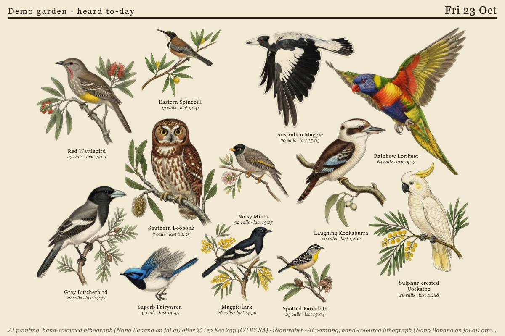
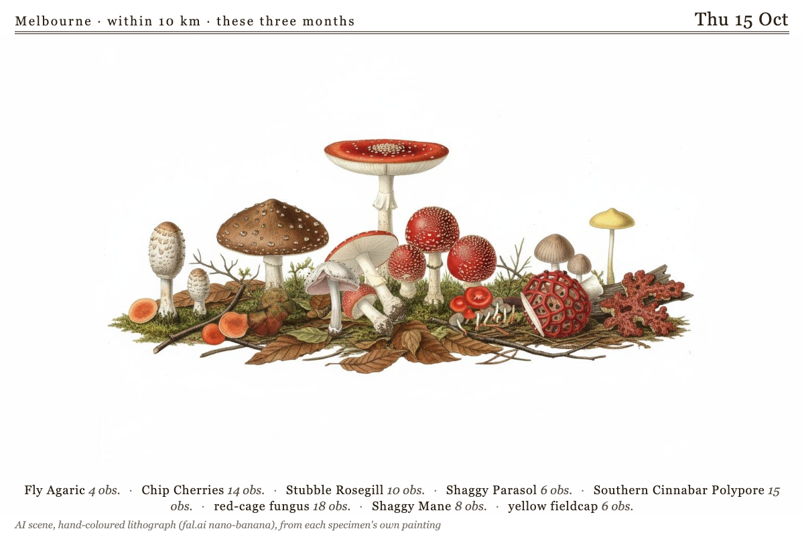
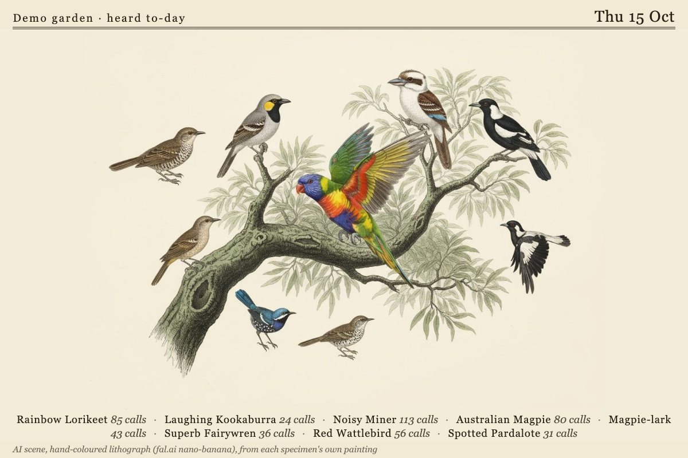

# Specimen Sheet

A [Tesserae](https://github.com/dmellok/tesserae) widget: the birds and wildlife around the panel, cut out and laid out together on one printed page.

One widget, three sources, one page:

| Source | What the sheet shows | The count under a name |
| --- | --- | --- |
| **BirdNET-Go** | The birds the microphone heard to-day (or this week) | calls, with when it was last heard |
| **iNaturalist** | What people have found near a place lately, or one person's own observations | observations, with the date and the observer |
| **GBIF** | What has been recorded near a place in this month of the year | records |

Until you point it at a BirdNET-Go server it runs a **demo garden** for the cell's location, so the page can be tried without a microphone. iNaturalist and GBIF need a place (or, for iNaturalist, a username).

## The page

Each specimen is cut out of its picture and the cut-outs are packed onto one sheet of paper: the largest in the middle, the rest in pairs of like size on either side of it, mirrored across the page and turned to face in, sized true to life (a crow large, a wren small) or by how often each was heard or recorded. Several arrangements are tried and the most balanced kept. Labels sit under each specimen as captions or as specimen tags, or the page carries numbers with a key beside it. A species with no picture yet is drawn as an empty mount of the size it will take, so nothing jumps when its picture lands.

**Leave out** drops species from the sheet, one per line: a common or scientific name, a genus (`Columba` drops every pigeon in it), a kind (`Insecta`, `insects`, `Birds`) or a pattern such as `*gull`. An excluded species frees its place for the next one. The plugin's settings carry an **Always leave out** list that applies to every cell; the widget's page under Widgets lists every species it has shown, to copy from.

After dark, with BirdNET-Go, the page can show the garden asleep (the moon, when it went quiet, the last bird heard) or keep only the night's birds.

## Pictures

A species gets the best picture the widget has to-day and moves up as better ones arrive:

1. **A classic plate** from the bundled pack (Audubon, Gould, Lear and others, public domain), for the birds the pack covers.
2. **The record's own photo** (iNaturalist, GBIF) or BirdNET-Go's thumbnail, credited at the foot of the page.
3. **An AI painting**, with **Pictures** set to AI paintings and a fal.ai key: each species is painted once per style from a photo of it, through fal.ai's nano-banana model, on plain white paper so it cuts out cleanly, at about US$0.04 a species, three new paintings per refresh under a daily limit you set. The sheet shows the plate or photo until each painting lands, and the foot counts "painting 3 of 8".

Thirty-three styles in seven groups, or your own prompt. **Plates and prints**: hand-coloured lithograph after Gould, watercolour after Audubon, black-ink engraving, Japanese woodblock, linocut, mid-century modern after Charley Harper, modern watercolour, field sketch. **Colour, clean**: Art Nouveau after Mucha, gouache poster, scientific plate after Keulemans, vintage stamp, stained glass, risograph. **Black and white, for 1-bit panels** (drawn without mid-tones): scraperboard, woodcut, stipple, silhouette, ink brush. **Four greys**: pencil study, toned lithograph, halftone, technical drawing. **Greyscale**: platinum print, charcoal, mezzotint. **Playful**: pixel art, origami, hats and monocles. **Birds aren't real**: a surveillance unit in watercolour, a patent drawing, a clockwork automaton, a drone. A third of the birds are painted in flight so a page is not all perches; a fungus is cut from its log, an insect pinned as in an entomological plate. **One dapper specimen a day** paints one species in a small hat, and perhaps a monocle, in whatever style the sheet is in: the same one all day, another to-morrow.

### Cut-outs

With a fal.ai key, every picture on the sheet (plate, photo or painting) gets an alpha mask from a background-removal model (BiRefNet, well under a cent a picture, once per picture). The mask is checked before it is trusted: the foreground has to be a sensible share of the frame, touch at most two edges, and have one piece that clearly outweighs the rest; that piece is kept (a plate's second bird or its caption is dropped), pinholes filled, specks removed. A mask that fails the check is remembered and the picture falls back to a soft oval, never a rectangle. Without a key, a plate on plain paper is cut by spreading in from its edges and a photo is shown as a soft oval.

### The painted scene

With AI paintings on, **Arrangement** can ask fal.ai to repaint the whole sheet as one picture with one background: on a shared branch, through a tree, round a bird bath, along a wire, at a feeder, in a meadow, all in flight, at a wetland's edge, in a cottage garden, or as a vignette of foliage. It is painted once every specimen is painted and cut out, again when the line-up changes and no more often than the interval you pick, at about US$0.04 each time. The model takes liberties with a scene whatever it is asked, so the names go in a legend under the picture rather than on the specimens.

## The paintings page

Under **Widgets → Specimen Sheet**: every painting with its credit and cut-out state, a form to paint one species in any style (dapper or not), a button to paint every species seen in one style, repaint, cut out again, delete, earlier versions kept and restorable, to-day's count against the limit with a reset, a live ticker of what fal.ai is painting now, and the list of species seen.

## Panels

Colour, greyscale and black-and-white. Pictures are converted and contrast-stretched for the greyscale settings; on black and white the type is thickened so the fine serif survives dithering.

## Settings

Plugin settings: the fal.ai key, the daily painting limit (6 to 96), and the Always leave out list. The key is only ever sent to `fal.run`.

## Network

The manifest declares `network:*` because the BirdNET-Go address is whatever you type in. What the widget reaches: your BirdNET-Go address; `api.inaturalist.org` and `inaturalist-open-data.s3.amazonaws.com`; `api.gbif.org`; `commons.wikimedia.org` and `upload.wikimedia.org` for plates; `en.wikipedia.org` for a sentence on a species when painting it; and `fal.run` plus `fal.media` only with a key.

## Files

Under the widget's data folder: `result_*.json` (the source's answers, kept for the refresh interval), `img/` (fetched pictures and resized copies), `masks/` (cut-outs and the day's count), `gen/` (paintings, their credits, scenes and collages, the day's count) and `gen/archive/` (earlier paintings), `rarity.json` (the days each bird was heard), `species_seen.json`.

## Where it came from

A rebuild of the Backyard Birds, Nature Nearby and Nature This Month collage pages as one widget, dedicated to the page. Those widgets keep their other layouts. The specimen sheet, the day's birds cut from old plates and laid out together on one page with the larger birds in the middle, follows [Fugleramme](https://github.com/arnegiacomo/fugleramme) by Arne Giacomo, a BirdNET-Go bird frame for a Raspberry Pi and an e-ink panel; this is a separate implementation and shares no code or artwork with it.

## Fonts

IM Fell English (SIL Open Font License) for the printed page; Archivo Narrow (SIL OFL) on black-and-white panels. Licences are in `fonts/`.

## Licence

AGPL-3.0-or-later. Plates are public domain; photos keep their observers' licences, as credited; AI paintings are credited to the model and the photo they were painted after.
